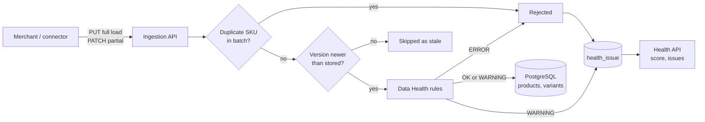

# CatalogSense

CatalogSense ingests merchant product catalogs, checks their quality and (from phase 2 on) makes them searchable.

Commerce search is only as good as the product data behind it. A missing price, a broken image or a duplicate SKU means a product that shoppers can't find or can't buy. CatalogSense catches these problems at ingestion time and gives the merchant a **Data Health** view with clear, fixable messages.

## What works today (phase 1)

- **Full loads** (`PUT`): the body is the whole catalog. Products missing from it are deleted.
- **Partial updates** (`PATCH`): only the products sent are created or updated.
- **Versioning**: each product carries a `version`. Updates that are older or equal to the stored version are skipped, so late or replayed events (e.g. webhooks delivered twice or out of order) can't overwrite newer data.
- **Data Health rules**: ERROR rules reject a product and keep the last good version. WARNING rules accept it and flag it.
- **Health score**: the share of tracked SKUs with no open issue, with counts per rule.



## Run it

Requirements: Docker, or Java 21 + Maven + a local PostgreSQL.

```bash
docker compose up --build       # PostgreSQL + the app on http://localhost:8080
./demo.sh                       # full load, health check, fix, health again
```

API docs: http://localhost:8080/swagger-ui.html

Run the tests:

```bash
mvn verify      # unit + Spring integration tests; the PostgreSQL test uses Testcontainers when Docker is available
```

## API

| Method | Path | What it does |
| --- | --- | --- |
| `PUT` | `/api/catalogs/{catalogId}/products` | Full load (replaces the catalog) |
| `PATCH` | `/api/catalogs/{catalogId}/products` | Partial update |
| `GET` | `/api/catalogs/{catalogId}/products?page=&size=` | List products |
| `GET` | `/api/catalogs/{catalogId}/products/{sku}` | One product with its variants |
| `GET` | `/api/catalogs/{catalogId}/health` | Health score and issue counts per rule |
| `GET` | `/api/catalogs/{catalogId}/health/issues?severity=ERROR` | Issues to fix, newest first |

Example product:

```json
{
  "sku": "TR-100", "name": "Trail Runner 100", "brand": "Northpeak", "category": "Shoes > Running",
  "price": 129.99, "currency": "CAD", "imageUrl": "https://cdn.example.com/tr-100.jpg", "version": 1,
  "variants": [{ "sku": "TR-100-BLK-9", "color": "Black", "size": "9", "inStock": true }]
}
```

## Data Health rules

| Rule | Severity | Checks |
| --- | --- | --- |
| `REQUIRED_FIELDS` | ERROR | name, version |
| `REQUIRED_FIELDS` | WARNING | brand, category (needed for facets) |
| `PRICE` | ERROR | price present and > 0, valid ISO 4217 currency, variant prices > 0 |
| `PRICE` | WARNING | variant price more than 10x the product price |
| `IMAGE_URL` | WARNING | image present, https URL |
| `VARIANTS` | ERROR | variant SKU present and unique |
| `VARIANTS` | WARNING | every variant out of stock |
| `DUPLICATE_SKU` | ERROR | the same SKU sent twice in one batch |

Adding a rule = one Spring `@Component` implementing `ValidationRule`.

## Design choices

- **Bad data is input, not an exception.** Products are not bean-validated into a 400; each problem becomes a `health_issue` with a message the merchant can act on. Only a malformed request (not a JSON array, too many products) returns 400/413.
- **A rejected update never destroys good data.** The previous accepted version stays live and the error shows in Data Health.
- **Idempotent, order-safe updates** through the `version` field, so the same batch can be retried safely.
- **Full load deletes only SKUs that are absent**, not SKUs that were sent but rejected.
- **Batch limit** of 10,000 products per request; larger catalogs are sent in chunks (phase 2 moves processing to a queue).

## Roadmap

- [x] Phase 1: ingestion API, versioning, Data Health, tests, Docker Compose
- [ ] CI: a GitHub Actions workflow is ready in `.github/workflows-disabled/`; move it to `.github/workflows/` to turn it on
- [ ] Phase 2: Kafka between intake and processing (back-pressure, retries, dead-letter topic), async job status
- [ ] Phase 3: OpenSearch index and a `/search` endpoint with facets, typo tolerance and an in-stock boost
- [ ] Phase 4: React + TypeScript UI with a search page and a Data Health dashboard
- [ ] Phase 5: Shopify connector (Admin GraphQL bulk export + `products/update` webhooks with HMAC verification)
- [ ] Phase 6: "Ask the catalog": natural-language questions answered from search results (RAG)

## Stack

Java 21, Spring Boot 3.4, Spring Data JPA, PostgreSQL 16, Flyway, JUnit 5, Testcontainers, Docker, GitHub Actions.
