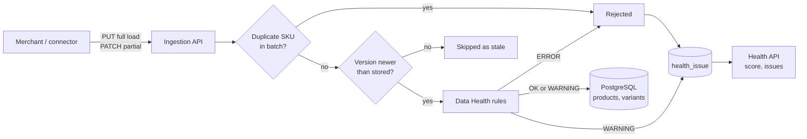
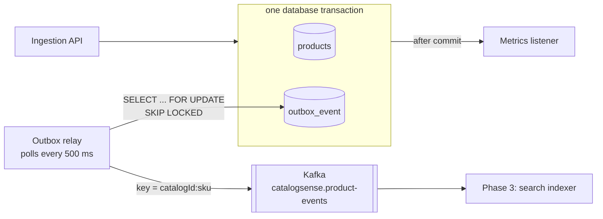

# CatalogSense

CatalogSense ingests merchant product catalogs, checks their quality, publishes every change to Kafka and (from phase 3 on) makes them searchable.

Commerce search is only as good as the product data behind it. A missing price, a broken image or a duplicate SKU means a product that shoppers can't find or can't buy. CatalogSense catches these problems at ingestion time and gives the merchant a **Data Health** view with clear, fixable messages.

## What works today

### Phase 1: ingestion and Data Health

- **Full loads** (`PUT`): the body is the whole catalog. Products missing from it are deleted.
- **Partial updates** (`PATCH`): only the products sent are created or updated.
- **Versioning**: each product carries a `version`. Updates that are older or equal to the stored version are skipped, so late or replayed events (e.g. webhooks delivered twice or out of order) can't overwrite newer data.
- **Data Health rules**: ERROR rules reject a product and keep the last good version. WARNING rules accept it and flag it.
- **Health score**: the share of tracked SKUs with no open issue, with counts per rule.



### Phase 2: product change events on Kafka (transactional outbox)

Every accepted upsert and every delete becomes a message on the `catalogsense.product-events` topic, so downstream services (the search indexer in phase 3, recommendations, analytics) can react without polling the database.

Writing to the database and to Kafka in the same request is the classic dual-write problem: if the commit fails after the send, consumers see a change that never happened; if the send fails after the commit, they miss one. CatalogSense uses a **transactional outbox** instead:



- **Same transaction:** the outbox rows are written by an event listener that requires the ingestion transaction (`Propagation.MANDATORY`). If the ingestion rolls back, no event exists.
- **Side effects after commit:** in-process listeners such as metrics use `@TransactionalEventListener(AFTER_COMMIT)`, so they never count work that was rolled back.
- **Immutable payloads:** events carry `ProductSnapshot` records, not JPA entities, so they are safe to serialize and to hand to other threads.
- **At-least-once delivery:** a row is marked published only after the broker acknowledged it (`acks=all`, idempotent producer). A crash in between means the message is sent again, so consumers de-duplicate on `eventId`.
- **Per-product ordering:** the message key is `catalogId:sku`, so all changes to one product land on the same partition. The relay sends rows in id order and stops a batch at the first failure, so a newer version is never sent before an older one.
- **Scales out:** rows are locked with `SKIP LOCKED`, so several app instances can relay in parallel without sending the same row twice. Published rows are purged after 7 days.

Message format (value is JSON, headers `eventType` and `eventId`):

```json
{
  "eventId": "6f1c...",
  "type": "ProductUpserted",
  "catalogId": "demo-store",
  "sku": "TSHIRT-001",
  "version": 2,
  "occurredAt": "2026-11-13T00:10:46Z",
  "product": { "name": "Classic tee", "price": 25.00, "currency": "CAD", "inStock": true, "variants": [ ... ] }
}
```

A `ProductDeleted` message has the same shape with `product: null`.

## Run it

Requirements: Docker, or Java 21 + Maven + a local PostgreSQL.

```bash
docker compose up --build       # PostgreSQL + Kafka + the app on http://localhost:8080
./demo.sh                       # full load, health check, fix, health again
```

API docs: http://localhost:8080/swagger-ui.html

Watch the product events while the demo runs:

```bash
docker compose exec kafka /opt/kafka/bin/kafka-console-consumer.sh \
  --bootstrap-server localhost:9092 --topic catalogsense.product-events \
  --from-beginning --property print.key=true
```

Run the tests:

```bash
mvn verify      # unit + Spring integration tests; Kafka tests use an embedded broker, the PostgreSQL test uses Testcontainers when Docker is available
```

## API

| Method | Path | What it does |
| --- | --- | --- |
| `PUT` | `/api/catalogs/{catalogId}/products` | Full load (replaces the catalog) |
| `PATCH` | `/api/catalogs/{catalogId}/products` | Partial update |
| `GET` | `/api/catalogs/{catalogId}/products?page=&size=` | List products |
| `GET` | `/api/catalogs/{catalogId}/products/{sku}` | One product with its variants |
| `GET` | `/api/catalogs/{catalogId}/health` | Health score and issue counts per rule |
| `GET` | `/api/catalogs/{catalogId}/health/issues?severity=ERROR` | Issues to fix, newest first |

Example product:

```json
{
  "sku": "TR-100", "name": "Trail Runner 100", "brand": "Northpeak", "category": "Shoes > Running",
  "price": 129.99, "currency": "CAD", "imageUrl": "https://cdn.example.com/tr-100.jpg", "version": 1,
  "variants": [{ "sku": "TR-100-BLK-9", "color": "Black", "size": "9", "inStock": true }]
}
```

## Data Health rules

| Rule | Severity | Checks |
| --- | --- | --- |
| `REQUIRED_FIELDS` | ERROR | name, version |
| `REQUIRED_FIELDS` | WARNING | brand, category (needed for facets) |
| `PRICE` | ERROR | price present and > 0, valid ISO 4217 currency, variant prices > 0 |
| `PRICE` | WARNING | variant price more than 10x the product price |
| `IMAGE_URL` | WARNING | image present, https URL |
| `VARIANTS` | ERROR | variant SKU present and unique |
| `VARIANTS` | WARNING | every variant out of stock |
| `DUPLICATE_SKU` | ERROR | the same SKU sent twice in one batch |

Adding a rule = one Spring `@Component` implementing `ValidationRule`.

## Design choices

- **Bad data is input, not an exception.** Products are not bean-validated into a 400; each problem becomes a `health_issue` with a message the merchant can act on. Only a malformed request (not a JSON array, too many products) returns 400/413.
- **A rejected update never destroys good data.** The previous accepted version stays live and the error shows in Data Health.
- **Idempotent, order-safe updates** through the `version` field, so the same batch can be retried safely.
- **Full load deletes only SKUs that are absent**, not SKUs that were sent but rejected.
- **Batch limit** of 10,000 products per request; larger catalogs are sent in chunks (a later phase can move intake itself behind a queue).

## Roadmap

- [x] Phase 1: ingestion API, versioning, Data Health, tests, Docker Compose
- [ ] CI: a GitHub Actions workflow is ready in `.github/workflows-disabled/`; move it to `.github/workflows/` to turn it on
- [x] Phase 2: product change events on Kafka through a transactional outbox (at-least-once, ordered per product)
- [ ] Phase 3: OpenSearch indexer consuming the product events, and a `/search` endpoint with facets, typo tolerance and an in-stock boost
- [ ] Phase 4: React + TypeScript UI with a search page and a Data Health dashboard
- [ ] Phase 5: Shopify connector (Admin GraphQL bulk export + `products/update` webhooks with HMAC verification)
- [ ] Phase 6: "Ask the catalog": natural-language questions answered from search results (RAG)

## Stack

Java 21, Spring Boot 3.4, Spring Data JPA, PostgreSQL 16, Flyway, Apache Kafka (spring-kafka), JUnit 5, Testcontainers, Docker, GitHub Actions.
